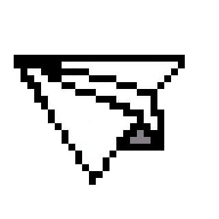

    
    

        
 ⤷  <strong>Studying</strong> Computer Science at <strong>FIAP</strong>

        
 ⤷  <strong>Graduated</strong> in Systems Development at <strong>SENAI</strong>

        
 ⤷  Interested in <strong>Artificial Intelligence, Machine Learning, Data Science and Automation</strong>

        
 ⤷  Passionate about <strong>continuous learning and exploring new technologies</strong>

    

    

## ── .✦ Technology Stack

**★ Main Skills:**

&nbsp;
&nbsp;
&nbsp;
&nbsp;
&nbsp;
&nbsp;
&nbsp;
&nbsp;
&nbsp;
&nbsp;
&nbsp;
&nbsp;
&nbsp;

**.ᐟ.ᐟ Learning:**

**⊹ ࣪ ˖ Tools:**

    

---

